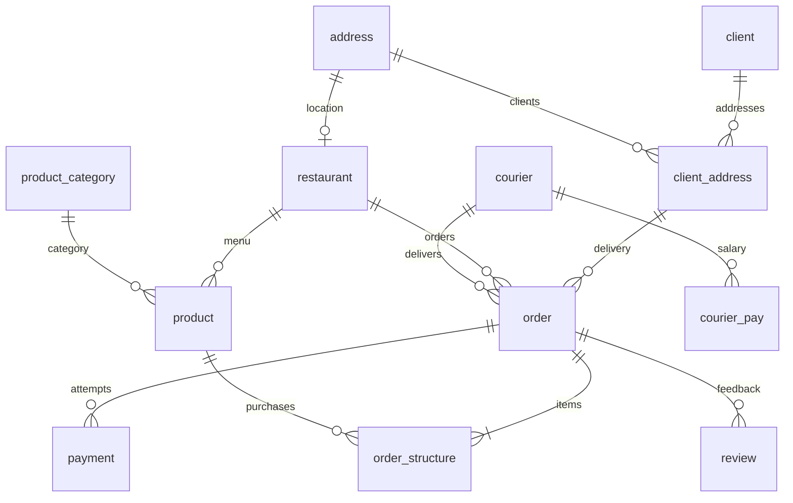

# Логическая модель

Полные типы и обязательность полей заданы в [01_tables.sql](schema/01_tables.sql). Исходная концептуальная модель сохранена в [docs/erd.md](../docs/erd.md).

| Отношение | Ключ | Атрибуты |
|---|---|---|
| client | client_id uuid | login varchar(80), password varchar(32), phone_number varchar(20) |
| address | address_id uuid | street varchar(120), house_number varchar(20), apartment_office varchar(20) |
| client_address | client_id + address_id | Два FK |
| restaurant | restaurant_id uuid | Название, адрес, описание, график, реквизиты, рейтинг, статус |
| courier | courier_id uuid | ФИО, телефон, статус, даты найма/увольнения, coefficient numeric(2,1) |
| courier_pay | year + month + courier_id | amount numeric(16,2), coefficient_used numeric(2,1) |
| product_category | product_category_id uuid | product_category_name varchar(80) |
| product | product_id uuid | Название, категория, ресторан, price numeric(12,2), URL, рейтинг, статус, описание |
| order | order_id uuid | Курьер, клиент, адрес, ресторан, даты, order_amount, комиссия, итог, статусы, описание |
| payment | payment_id uuid | order_id, type enum, amount numeric(14,2), transaction_ref varchar(100), timestamp, status enum |
| order_structure | order_id + product_id | quantity numeric(10,3), unit_price numeric(12,2) |
| review | review_id uuid | order_id, entity_id, entity_type enum, текст, URL, rating numeric(3,2), timestamp |

Ограничения для полиморфного объекта отзыва и контролируемые вычисляемые поля разобраны в [constraints.md](constraints.md). Столбцов для городов, карт, ФИО клиентов, скидок и возвратов нет.

Автор отзыва выводится по цепочке `review.order_id → order.client_id → client`. Представление `review_with_client` показывает `client_id` и поддерживает INSERT/UPDATE/DELETE с проверкой автора; повторное хранение клиента в `review` исключено при нормализации.
